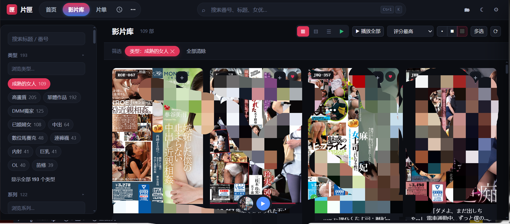
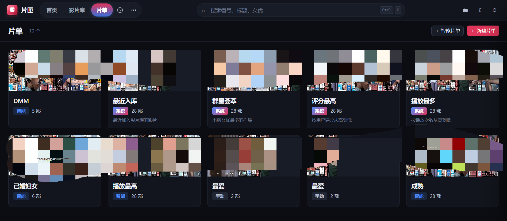
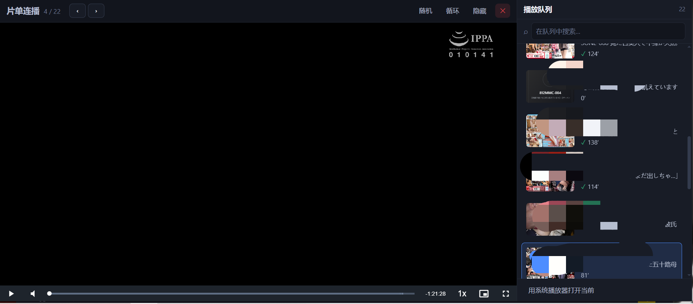
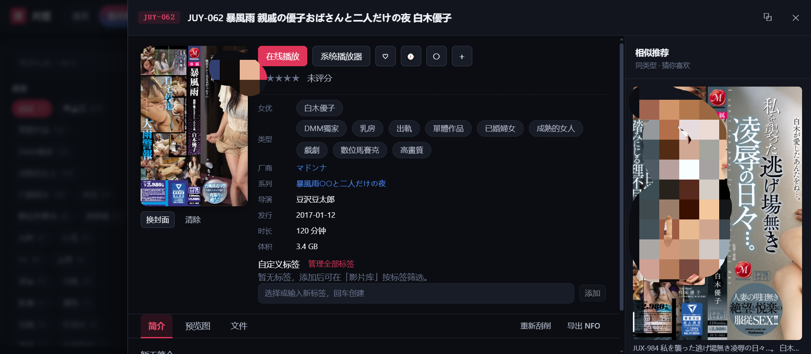
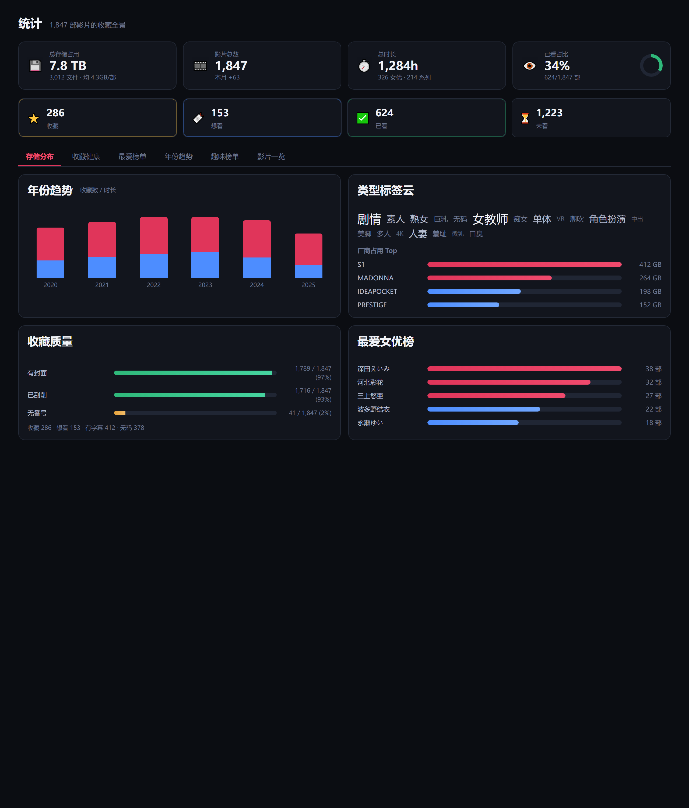
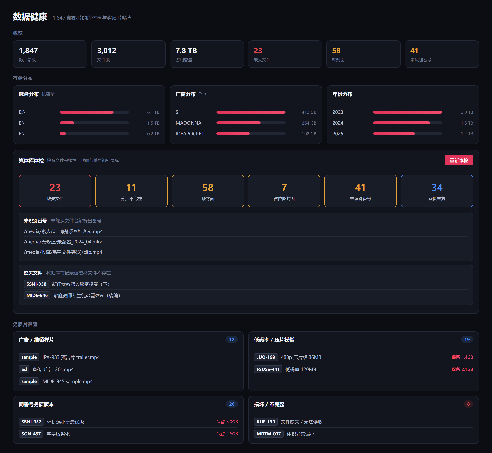

<h1 align="center">片匣 · AVM</h1>

<p align="center"><b>Adult Video Manager</b> — 本地优先、自托管的 AV 收藏资料库</p>

<p align="center">
  <a href="README.md">简体中文</a> · <a href="README.zh-TW.md">繁體中文</a> ·
  <a href="README.en.md">English</a> · <a href="README.ja.md">日本語</a>
</p>

<p align="center">
  
  
  
  
  
  <a href="LICENSE"></a>
  <a href="https://github.com/dengji85/avm/releases"></a>
  <a href="https://github.com/dengji85/avm/stargazers"></a>
</p>

<p align="center">
  
  <br/><sub>影片库 · 分面筛选 / 卡片墙 / 来源角标（封面为中性占位块）</sub>
</p>

把命名混乱、散落各处的收藏，变成一处**能搜、能去重、能刮削、能统计、能播放**的私人资料库。

- **本地优先**：FastAPI + SQLite + Vue 3，单文件 exe 或 Docker 运行，数据全在你自己的机器上，无需账号。
- **领域适配**：番号归一、多版本归并、素人/无码元数据补齐，不是把通用影视刮削器硬套过来。
- **按需增强**：AI、语音识别、人脸裁切、浏览器插件全部可选，不装也能用核心功能。

**[目录](#目录)** · [特性](#特性) · [快速开始](#快速开始) · [配置](#配置) · [插件与扩展](#插件与扩展) · [开发](#开发) · [文档](#文档) · [许可证](#许可证)

---

## 特性

| 领域 | 能力 |
| --- | --- |
| **建库识别** | 递归扫描、番号归一（`IRO061C` → `IRO-061`）、字幕/无码/VR/分卷标记识别；多版本归并 + 内容级去重 |
| **元数据** | 可插拔刮削源（JavBus / JavDB / AV-Wiki / FC2 / 本地 NFO / 自定义规则）跨源回退；封面、竖版海报、女优资料、NFO 双向归档 |
| **检索策展** | 分面筛选、全文搜索、女优墙、标签云、智能片单、相似推荐、键盘流操作 |
| **播放观看** | 网页播放本地文件 / `.strm` / HLS；续播、播放队列、系统播放器监控、年度回顾；字幕匹配、AI 翻译与时间轴校准 |
| **在线来源** | 来源管理与失效自愈、浏览器插件一键入库、观看心跳与断网补报、文本批量导入番号、统一代理出口 |
| **维护整理** | 数据健康体检、来源体检、定时增量扫描、NFO/CSV 导出 |
| **访问隐私** | 令牌 + HttpOnly 会话、TOTP、隐私锁、局域网扫码、反代鉴权；默认不联网上报，四语言界面 |

> AI 功能兼容任意 OpenAI 协议端点或本地 Ollama，**未启用自动降级**，库数据不因 AI 外发。

<details>
<summary><b>更多截图</b>（片单 · 播放队列 · 详情 · 统计 · 健康体检）</summary>

<table><tr>
<td align="center"><br/><sub>片单</sub></td>
<td align="center"><br/><sub>播放队列</sub></td>
<td align="center"><br/><sub>详情抽屉</sub></td>
</tr></table>
<p align="center"><br/><sub>统计</sub></p>
<p align="center"><br/><sub>数据健康体检</sub></p>

</details>

---

## 快速开始

| 部署方式 | 要求 |
| --- | --- |
| Windows 单文件 exe | Windows 10/11 x64；无需 Python / Node |
| Docker / NAS | `linux/amd64`、`linux/arm64`（full 仅 amd64），≥1GB 内存，建议 `--shm-size=256m` |
| 源码运行 | **Python 3.11+**、**Node 20+** |

### ① Windows 单文件（最省事）

从 **[Releases](https://github.com/dengji85/avm/releases/latest)** 下载 `AVM-1.17.0.exe` → 放到任意目录双击启动 → 用 `data/access_token.txt` 里的令牌登录。升级只需替换 exe，`data/` 原地保留。

### ② Docker / NAS（推荐常驻）

```bash
docker run -d --name avm \
  -p 8770:8770 -e TZ=Asia/Shanghai -e PUID=1000 -e PGID=1000 \
  -v /path/to/data:/data -v /path/to/media:/media:ro \
  --shm-size=256m --restart unless-stopped \
  ghcr.io/dengji85/avm:latest
```

也可直接用 [`docker-compose.yml`](docker-compose.yml)：`docker compose pull && docker compose up -d`。
镜像标签：`latest`（稳定）· `latest-full`（含语音依赖，仅 amd64）· `main`（最新构建）· `1.17.0`（固定版本）。
首次令牌：`docker compose exec avm cat /data/access_token.txt`；媒体目录填**容器内路径**（如 `/media`）。详见 [Docker 部署指南](docs/Docker部署.md)。

### ③ 源码运行（开发）

```bash
git clone https://github.com/dengji85/avm.git && cd avm
pip install -r requirements.txt
cd web_src && npm install && npm run build && cd ..
python run.py serve                       # http://127.0.0.1:8770
```

热更新开发：后端 `python run.py serve --reload --no-browser`（8770），前端 `cd web_src && npm run dev`（5173，`/api` 自动代理）。

### 首次使用

打开 `http://127.0.0.1:8770` → 粘贴 `data/access_token.txt` 令牌 → 跟随 3 步向导（语言 / 影片目录 / 目标）→ 自动扫描并报告找到多少部。抽帧与转封装需要 FFmpeg（exe 版不内置），到「设置 → 扩展组件」安装即可。详见 [使用手册](docs/使用手册.md)。

---

## 配置

运行时数据集中在一处，整体拷贝即备份（Docker 对应 `/data` 卷）：

```
data/
├── library.db          SQLite 主库
├── config.json         配置（设置页写入，新版本自动补默认值）
├── access_token.txt    访问令牌（0600）
├── covers/             封面 / 海报 / 头像
└── ext/packages/       扩展组件离线包目录
```

| 环境变量 | 默认值 | 说明 |
| --- | --- | --- |
| `AVM_DATA_DIR` | `./data`（容器 `/data`） | 数据目录 |
| `AVM_HOST` / `AVM_PORT` | `127.0.0.1` / `8770`（容器 `0.0.0.0`） | 监听地址 |
| `AVM_ACCESS_TOKEN` | 启动时随机生成 | 预设访问令牌 |
| `AVM_PUBLIC_URL` | 空 | 反代 / 局域网对外地址（影响扫码） |
| `PUID` / `PGID` / `TZ` | `1000` / `1000` / 系统 | 容器属主与时区 |
| `HTTP_PROXY` / `HTTPS_PROXY` | 空 | 容器不继承宿主代理，需要时显式声明 |

主要配置段：`network`（统一代理）、`stream`、`ingest`、`ai`、`scraper`、`cover`、`server`、`privacy`。反向代理部署请先读 [安全与隐私设计](docs/安全与隐私设计.md)。

**升级 / 备份**：exe 换文件、Docker 换镜像即可，数据库自动迁移；备份 = 停止服务后拷贝整个 `data/`。详见 [升级指南](docs/升级指南.md)。

---

## 插件与扩展

**[AVM Companion](extension/avm-companion.user.js)**（`v0.5.8`，**版本独立于主程序**）是 Tampermonkey / Violentmonkey 用户脚本：影片页一键入库、上报真实观看时长、断网补报。每个 Release 会一并附带 `avm-companion-<插件版本>.user.js`，直接下载安装即可（文件名带版本，升级时不会装重复）。安装脚本 → 在 AVM「设置 → 浏览器接入」复制专用令牌 → 播放几秒后点浮标。只在**主动点击后**上报番号、标题、页面地址与播放地址，不上传正文 / Cookie / DOM；本机地址不注入。协议见 [插件设计文档](docs/浏览器插件与在线资源设计.md)。

**可选扩展组件**：FFmpeg（抽帧 / 转封装）、人脸定位（海报智能裁切）、语音识别 + 模型（提取对白）、MetaTube（补充刮削源）。
离线安装推荐：把 `.zip` 放进 `data/ext/packages/`，在「设置 → 扩展组件 → 手动导入」下拉选中即可（零上传）；NAS 可指定共享目录。详见 [扩展组件手册](docs/扩展组件手册.md)。

## 项目结构

```
app/              FastAPI 后端（api.py / routers / store.py / db.py / config.py）
  providers/      可插拔刮削源      ai_*.py / agent.py   可选 AI 能力
  ingest.py       浏览器接入        images.py            封面与海报
web_src/src/      Vue 3 前端（views / components / i18n 四语言）
web_dist/         前端构建产物      extension/           浏览器用户脚本
docs/             使用 / 部署 / 开发 / 安全文档     tools/   离线包打包脚本
run.py / build.py CLI 入口 / PyInstaller 打包
```

**技术栈**：Python 3.11 · FastAPI · Uvicorn · SQLite / Vue 3 · Vite 4 · video.js / requests · BeautifulSoup · 可选 CDP / PyInstaller · Docker 多架构镜像。

---

## 开发

```bash
python -m compileall -q app                                        # 语法检查
python -c "from app.main import app; print(len(app.openapi()['paths']))"   # 路由干跑
cd web_src && npm run build                                       # 前端构建
python run.py scan --full / dedupe / stats / export / organize / mcp / ai-check / web-check
python build.py                                                   # → dist/AVM-1.17.0.exe
```

> 项目**目前没有单元测试框架**，CI 只做多架构镜像与 Release 构建；正确性依赖编译检查、OpenAPI 干跑、前端构建与真实浏览器验证。开发约定见 [AGENTS.md](AGENTS.md) 与 [开发文档](docs/开发文档.md)。

## 文档

| 使用 | 部署与运维 | 设计与开发 |
| --- | --- | --- |
| [使用手册](docs/使用手册.md) | [Docker 部署](docs/Docker部署.md) | [开发文档](docs/开发文档.md) · [AGENTS.md](AGENTS.md) |
| [扩展组件手册](docs/扩展组件手册.md) | [升级指南](docs/升级指南.md) | [安全与隐私设计](docs/安全与隐私设计.md) |
| [常见问题见下方](#常见问题) | [打包指南](docs/打包指南.md) | [AI 能力设计](docs/AI能力设计.md) · [插件设计](docs/浏览器插件与在线资源设计.md) · [CHANGELOG](CHANGELOG.md) |

## 隐私与安全

数据全部本地保存，**默认不联网上报**；联网只发生在你启用的数据源、AI 端点与插件主动入库时。令牌本地随机生成，会话为 HttpOnly Cookie，支持 TOTP、可信设备、隐私锁与登录审计。
发现安全问题请**不要开公开 Issue**，通过 GitHub 私密安全公告或私信维护者报告。请仅用于管理**合法持有**的本地文件，并遵守当地法律与数据源条款。

## 常见问题

| 问题 | 处理 |
| --- | --- |
| 扫不到影片 | 检查目录、100MB 最小体积、扩展名与忽略关键词；向导会列出排查项 |
| 令牌在哪 | 桌面版 `data/access_token.txt`；容器 `docker compose exec avm cat /data/access_token.txt` |
| Docker 填哪个路径 | 一律填**容器内**路径（如 `/media`），并挂载宿主目录 |
| 封面糊 / 无预览图 | 安装 FFmpeg；过小的源图会回退到清晰的裁切版本 |
| 播放 403 / 黑屏 | 看「来源体检」的原因：Cloudflare 硬阻断需换出口节点或回源站 |
| 前端改了看不到 | 强制刷新（Ctrl+F5）；开发时用 `http://localhost:5173` 热更新 |

---

## 许可证

[MIT](LICENSE) © dengji85 — 仅供个人学习与管理自用收藏；请遵守当地法律与数据源条款。
多语言 README 更新可能滞后，**以简体中文版为准**。

## 致谢

[FastAPI](https://fastapi.tiangolo.com/) · [Vue.js](https://vuejs.org/) · [Vite](https://vitejs.dev/) · [video.js](https://videojs.com/) · [Pillow](https://python-pillow.org/) · [faster-whisper](https://github.com/SYSTRAN/faster-whisper) · [SQLite](https://sqlite.org/) · [PyInstaller](https://pyinstaller.org/) 及所有数据源与头像项目的维护者。
