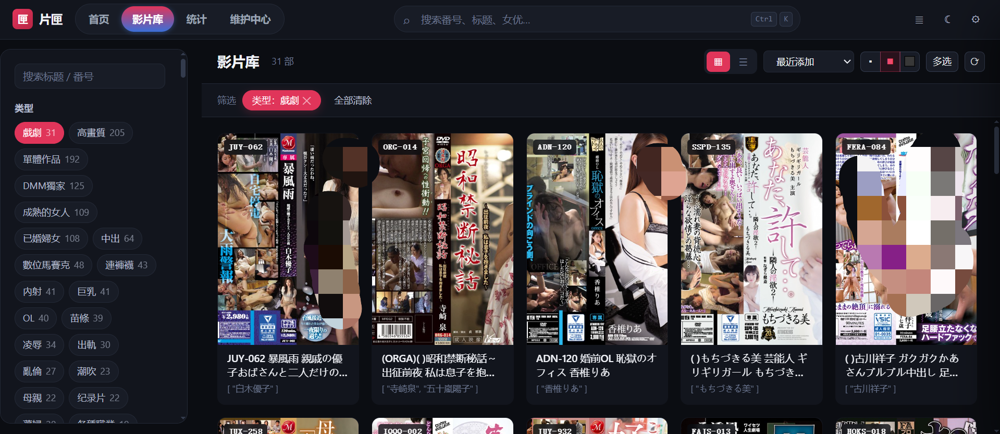
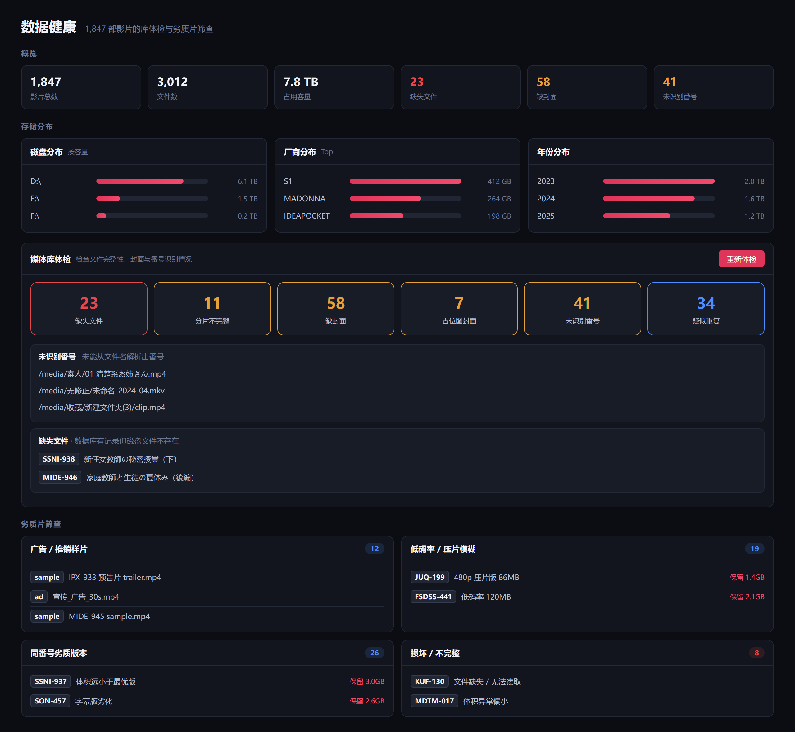
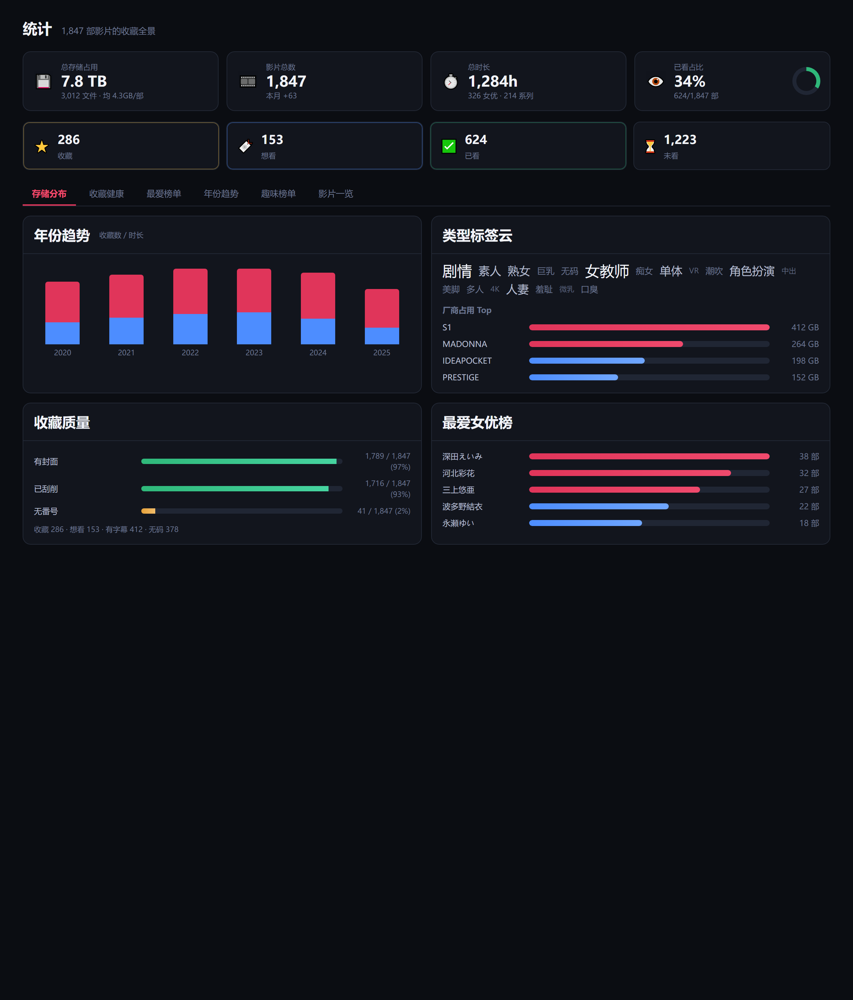
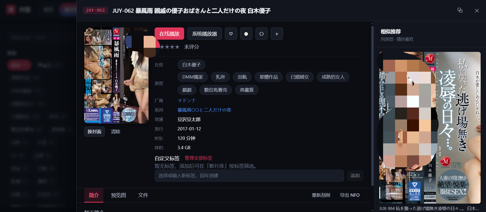

<h1 align="center">片匣 · AVM（Adult Video Manager）</h1>

<p align="center">
  <b>本地優先 · 隱私安全 · 可自託管</b><br/>
  把硬碟裡命名亂七八糟、散落各處的 AV 收藏，變成一處<b>能檢索、能策展、能回看</b>的私人資料庫。
</p>

<p align="center">
  
  
  
  
  
  
  
  
  
</p>

<p align="center">
  <a href="#為什麼需要片匣">為什麼需要它</a> ·
  <a href="#核心功能">核心功能</a> ·
  <a href="#為什麼選片匣而不是別的工具">為什麼選它</a> ·
  <a href="#本次更新亮點未發布">更新亮點</a> ·
  <a href="#下載與安裝">下載</a> ·
  <a href="#快速開始">快速開始</a>
</p>

---

## 😩 你有没有這些「收藏老毛病」？

- 硬碟換了一茬又一茬，**存了上千部，卻根本找不到**想看的那一兩部
- 同一部片在庫裡**躺了七八份**：無碼版、有碼版、中字版、壓片版……佔空間還分不清
- 檔名是 `IRO061C`、`SONE-760CH`、`300MAAN-123` 這種**野路子命名**，普通工具一概識別不了
- 封面張冠李戴、刮削失敗，**素人片連封面都沒有**
- 「上次那部女主是老師的」——**靠腦子想，想不起來**
- 看到一半被打斷，**進度丟了，下次從頭來**
- 怕隱私外洩、怕平台關站、怕換電腦收藏全沒了

**片匣就是專門給資深愛好者治這些毛病的。**

---

## ✅ 為什麼需要片匣

一句話：**你的收藏，值得一個像樣的「圖書館」，而不是一堆資料夾。**

| 沒有片匣 | 用了片匣 |
| --- | --- |
| 檔案命名混亂，靠記憶翻找 | 番號自動歸一、分面篩選 + 語意搜尋，秒定位 |
| 同一部重複七八份 | 內容級去重 + 多版本歸併，只留最佳版 |
| 封面缺失、刮削失敗 | 多源可插拔 + 跨源回退，有番號素人片也補齊封面 |
| 看沒看過全憑印象 | 零配置觀看清監控，自動記進度、看沒看完一目了然 |
| 收藏在別人家的伺服器 | 全本地、無帳號、不聯網上報，資料拷走即用 |

> **全程本地執行，預設不聯網上報。AI 也走你自己的端點，金鑰只發給你配的地址——你的收藏，始終是你自己的。**

---

## ✨ 核心功能

<p align="center">
  
</p>

- **🗂 自動掃描建庫**：遞迴掃描目錄，自動剝離站點/發佈組/技術雜訊，跳過 sample/預告/資源回收桶等；小預覽片直接忽略。
- **🔍 野路子番號識別**：`IRO061C`、`SONE-760CH`、`300MAAN-123` 這類「字母緊貼數字、帶版本尾巴」的命名也能歸一成 `IRO-061` / `SONE-760`，並自動識別字幕(`-C`)/無碼(`-U`)/VR/4K/分卷。
- **🧹 多版本歸併 + 內容去重**：無碼/有碼/導剪/中字自動歸同一部；按「大小 + 內容雜湊」識別精確重複。**明顯的分割（`-cd1`/`(1)`/`-a`）識別為合集，絕不誤判成重複、絕不誤刪。**
- **🖼 元資料刮削**：可插拔資料源（JavBus / JavDB / AV-Wiki / 本地 `.nfo` / 自訂 JSON·HTML 規則），補齊封面、女優、類型、系列、廠商、評分、簡介；刮不到也能手動補。
- **🤖 可選 AI 增強**：相容任意 OpenAI 協定端點（雲端填 Key 或本地 Ollama 免 Key），未啟用自動降級。右下角 ✨ 助手懸浮球任意頁面喚起：自然語言找片、簡介/標籤生成、字幕翻譯、劇情問答（標注時間依據）與**問庫**（口味畫像 / 觀看統計 / 庫健康——統計在本機執行，模型只解析問題，庫資料不出本機）。
- **📺 零配置觀看清監控**：把檔案丟給 VLC / PotPlayer / MPC / mpv，後台自動記「看了多久、看到哪、看沒看完」；續播進度、相似推薦、「我的觀影」偏好分析，下一部不糾結。
- **🩺 資料健康體檢**：六類媒體問題（缺失檔案 / 分片不完整 / 缺封面 / 佔位圖 / 未識別番號 / 疑似重複）+ 四類劣質片篩查（廣告樣片 / 低碼率 / 同番號劣質版 / 損壞），一鍵保留最佳版、清理冗餘。
- **🎴 畫廊策展**：卡片牆 + 女優牆 + 標籤雲 + 智慧片單（按規則自動聚合）+ 相似推薦，把「囤」變成「能翻出來看」。
- **📡 遠端存取**：手機/區網裝置掃碼即開，Token 鑑權 + 防火牆放行提示（`edge=yes` 邊緣穿越，不關整個防火牆也能通）。
- **⏱ 定時自動掃描**：下載新片後按週期自動增量入庫，不用每次手動點掃描。
- **💬 字幕匹配**：瀏覽器直接選字幕檔案上傳，按番號對齊重新命名，系統播放器開啟即載入。

---

## 🆚 為什麼選片匣而不是別的工具

市面方案大致兩類：**通用媒體刮削器**（TinyMediaManager、MediaElch、XBVR 等——影視為主，AV 只是勉強相容）和**各種 JAV 小腳本**（能力單一、無介面）。片匣是**專為 AV 收藏做領域適配的一站式本地資料庫**。

| 你真正在乎的 | 通用刮削器 | 自建腳本 | **片匣 AVM** |
| --- | --- | --- | --- |
| **野路子番號認得出？** | 通常只認規範命名 | 單源查號，無歸一化 | 7 類規則專用解析，歸一化 + 標記識別 |
| **同一部不再躺七八份？** | 多版本需手動歸併 | 基本不支援 | 自動歸併 + 內容級去重，分段不誤判 |
| **AV 元資料準？** | 對 AV 編目偏弱、封面易錯 | 依賴單站，掛了即空 | 多源可插拔 + 跨源回退，有番號素人片也補封面 |
| **強反爬源（AV-Wiki）？** | 不涉及 | 需手動養瀏覽器 | 內建 CDP 抓取，常駐 headless Chrome 自動繞過驗證頁（需本機已裝 Chrome，否則自動回退普通請求） |
| **以「作品」而非「資料夾」策展？** | 以資料夾為中心 | 只有清單 | 女優牆 / 標籤雲 / 智慧片單 / 相似推薦 |
| **中斷能續播？** | 需播放器插件 | 無 | 零配置監控任意系統播放器，自動記進度 |
| **庫髒了能一鍵看清？** | 基本無 | 無 | 六類體檢 + 四類劣質片篩查，一鍵清理 |
| **AI 語意搜尋？** | 多數無 | 無 | 可選，相容任意 OpenAI 端點 / 本地 Ollama |
| **隱私 & 部署？** | 桌面 GUI / 常駐服務 | 散裝腳本 | 純本地 Web、無帳號、單命令打包免安裝 exe |

> **簡言之：它不是又一個「能放影片的網頁」，而是為 AV 收藏這個特殊領域做了大量領域適配（番號、去重、素人、觀看回歸、體檢）的本地資料庫。**

---

## 🌟 本次更新亮點（未發布）

- **🤖 AI 助手庫模式**：右下角懸浮球任意頁面喚起；自然語言找片、「今晚看什麼」口味加權推薦、問庫（口味畫像 / 觀看統計 / 庫健康）——統計在本機執行，模型只解析意圖，**庫資料不出本機**；可選「AI 解讀」把統計組織成人話（僅聚合數字、預設關閉）。
- **🧩 擴充元件**：FFmpeg 與語音辨識元件 / 模型在設定裡**一鍵安裝**（斷點續傳、多源回退、離線匯入、解除安裝），不再需要命令列。
- **🔊 語音對白提取 + 無字幕 AI 簡介**：詳情頁一鍵提取對白餵給 AI 理解劇情；沒有字幕的影片也能按元資料生成簡介。
- **🔍 資料透明化**：來源標註（頁面內 / 外部 / 後台）、完整提示詞與回應可查、一鍵清空。

完整變更見 **[`CHANGELOG.md`](CHANGELOG.md)**。

---

## 📦 下載與安裝

不想自己打包？直接下載發布包（Windows 單資料夾壓縮包，解壓即用）：

<p align="center">
  <a href="https://github.com/dengji85/avm/releases/latest">
    
  </a>
</p>

1. 到 **[Releases](https://github.com/dengji85/avm/releases)** 下載最新 `AVM-win64.zip`。
2. 解壓到任意目錄（如 `D:\AVM\`），雙擊 `AVM.exe` 啟動，自動開啟瀏覽器進入 Web UI。
3. 資料（庫 / 封面 / 設定）在 `data/` 目錄，**整體拷貝即備份遷移**。

**Docker / NAS 部署（群暉 · 威聯通 · Unraid · TrueNAS）**

映像由 GitHub Actions 自動建置並推送至 GHCR（`linux/amd64` + `linux/arm64`），NAS 上**無需編譯**：

```bash
docker run -d --name avm \
  -p 8770:8770 \
  -e TZ=Asia/Shanghai \
  -e PUID=1000 -e PGID=1000 \
  -v /path/to/data:/data \
  -v /path/to/media:/media:ro \
  --shm-size=256m \
  --restart unless-stopped \
  ghcr.io/dengji85/avm:latest
```

或使用專案根目錄提供的 `docker-compose.yml`：

```bash
docker compose pull && docker compose up -d
```

**映像標籤怎麼選**：

| 標籤 | 含義 | 適合 |
| --- | --- | --- |
| `latest` | 最近一次正式發佈，穩定 | 日常使用（推薦） |
| `main` | `main` 分支最新建置，含尚未正式發佈的修正 | 想第一時間驗證新修正、回報問題 |
| `1.14.0` | 固定版本，不隨更新變化 | 需要版本可控 |

> 說明：`latest` 只在發佈新版本時更新，**不會被 `main` 的建置覆蓋**；想提前拿到修正請拉 `main`。

* **首次存取需要登入**：權杖寫在容器內 `data/access_token.txt`（`docker compose exec avm cat /data/access_token.txt`），或以環境變數 `AVM_ACCESS_TOKEN` 預設；在頁面貼上權杖即可登入，登入後可在「設定 → 存取」登出 / 管理工作階段。
* 媒體庫在「設定 → 媒體庫」填**容器內路徑**（如 `/media`）。
* 資料（設定 / 資料庫 / 封面 / 頭像 / 預覽）全在 `/data` 卷，升級只需換映像。
* 映像預設內建 `ffmpeg` 與 `chromium`；自建時可用 `--build-arg INSTALL_CHROMIUM=0` 精簡。
* 容器內無桌面環境，「用系統播放器 / 在資料夾中顯示」會自動隱藏，刪除預設為「僅移出媒體庫」。

> 完整說明（NAS 各平台、環境變數、反向代理、升級、FAQ）見 **[docs/Docker部署.md](docs/Docker部署.md)**；反代部署下的鑑權與會話安全必讀 **[docs/安全与隐私设计.md](docs/安全与隐私设计.md)**。

---

## 🚀 快速開始

### 方式一：源碼執行（開發）

```bash
pip install -r requirements.txt
python run.py serve            # 後端 http://127.0.0.1:8770
cd web_src && npm install && npm run dev   # 前端 http://localhost:5173
```

### 方式二：建置後整體託管

```bash
cd web_src && npm install && npm run build
python run.py serve            # 直接託管 web_dist/
```

### 打包為免安裝版

```bash
python build.py                # 生成 dist/片匣/片匣.exe
```

---

## 🤖 AI 增強使用教學（可選）

> AI 走你自己設定的端點（雲端 Key 或本地 Ollama 免 Key），未啟用時相關功能自動降級，不影響其它功能。設定入口：**AI 中心**（模型 / 提示詞 / 呼叫紀錄 / 術語表）。

### AI 助手（右下角 ✨ 懸浮球）

任意頁面點懸浮球喚起；打開某部影片詳情後，助手自動帶上該片的上下文。

- **影片模式**（有上下文）：AI 寫簡介（有字幕按字幕總結，沒有則按元資料）、標籤建議、字幕翻譯、劇情問答（標注 `[mm:ss]` 依據）、相似推薦。
- **庫模式**（無上下文）：問整個收藏——
  - **自然語言找片**：「小峰由莉的高分片」「S1 的古裝」→ 解析成條件 → 結果直接點開詳情；
  - **問庫**：「我最常看哪類片」「看了多少部」「多少部還沒簡介」——統計在本機執行，**模型只負責理解問題，庫資料不出本機**；
  - **今晚看什麼**：按觀看歷史的口味加權推薦，不花 token。
- **隱私**：每次請求與回應都可在「AI 中心 → 呼叫紀錄」查看並清空；「AI 解讀」預設關閉，雲端模型只收到聚合數字，本地 Ollama 自動全量。

### 擴充元件（設定 → 擴充元件）

FFmpeg 與語音辨識按需安裝，全程圖形介面，不用敲命令列：

1. **FFmpeg**（約 100MB）：封面抽幀、預覽圖、內嵌字幕偵測、瀏覽器播放轉封裝都依賴它 → 一鍵安裝。
2. **語音辨識**（元件約 170MB + 模型 small 約 460MB）：兩樣裝好 → 影片詳情「提取對白」→ AI 依據對白理解劇情。
3. 裝不上 / 不想連網：官方 zip 或已有目錄**手動匯入**；換碟改元件根目錄即可。
4. Docker 鏡像已預裝 FFmpeg，語音元件在容器內同樣頁面安裝（落在掛載卷，升級不丟）。

按平台詳細教學（Windows 攜帶版 / 原始碼 / Docker NAS / 離線內網）見 **[docs/擴充元件手冊.md](docs/擴充元件手冊.md)**。

---

## 🖼 更多介面

<details>
<summary><b>展開模組截圖</b>（資料健康 · 統計 · 詳細）</summary>

<br/>

<p align="center">
  
  <br/><sub>資料健康：六類體檢 + 四類劣質片篩查</sub>
</p>

<p align="center">
  
  <br/><sub>統計：儲存 / 影片數 / 時長 / 已看佔比 + 年份趨勢 + 標籤雲 + 女優榜</sub>
</p>

<p align="center">
  
  <br/><sub>詳細抽屜：封面 + 續播 + AI 簡介 + 相似推薦</sub>
</p>

</details>

> 截圖中封面區域為中性佔位塊，不代表真實內容；真實封面由你本地元資料決定。

---

## 🔒 隱私與合規

- 所有收藏資料均在本地，**預設不聯網上報**。
- 聯網僅發生在：你啟用的資料源、以及你自行配置的 AI 端點。
- 請僅用於管理你**合法持有**的本地檔案，並遵守所在地區法律法規與資料源站點服務條款。

---

## 🛠 技術堆疊

| 層 | 技術 |
| --- | --- |
| 後端 | Python · FastAPI · SQLite |
| 前端 | Vue 3 · Vite · 原生 CSS 變數主題 |
| 抓取 | Chrome DevTools Protocol（headless Chrome）· 多源適配器 |
| 打包 | PyInstaller · npm run build |

## 📈 專案數據

<p align="center">
  <a href="https://star-history.com/#dengji85/avm&amp;Date">
    
  </a>
</p>

- **Star 成長曲線**：由 [star-history.com](https://star-history.com) 依據 GitHub 公開 API 繪製
- **安裝包下載量**：GitHub Releases 的累計下載次數（上方 Downloads 徽章）

## 📄 授權

MIT —— 僅供個人學習與管理自用收藏。

---

完整使用說明見 **[`docs/使用手册.md`](docs/使用手册.md)**，開發文件見 **[`docs/开发文档.md`](docs/开发文档.md)**，升級遷移見 **[`docs/升级指南.md`](docs/升级指南.md)**，安全與隱私（反代鑑權、會話、防窺）見 **[`docs/安全与隐私设计.md`](docs/安全与隐私设计.md)**，更新歷史見 **[`CHANGELOG.md`](CHANGELOG.md)**。
